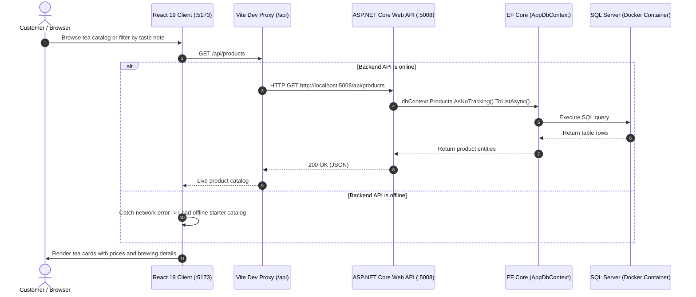

# Lumen

Lumen is a modern specialty tea and ceremonial matcha e-commerce web application. Designed for both tea lovers and beginners, Lumen offers curated artisanal teas — ceremonial matcha, roasted hojicha, genmaicha, sencha, black tea, and milk tea blends — paired with transparent brewing guides, taste meters, and a planned AI-powered tea recommendation assistant.

---

## Tech Stack

### Frontend


-443E38?style=for-the-badge&logo=react&logoColor=white)
-6E9F18?style=for-the-badge&logo=vitest&logoColor=white)

### Backend


-8E75C2?style=for-the-badge&logo=googlegemini&logoColor=white)
-512BD4?style=for-the-badge&logo=dotnet&logoColor=white)

### Database

-0078D4?style=for-the-badge&logo=microsoftazure&logoColor=white)
-003B57?style=for-the-badge&logo=sqlite&logoColor=white)

### Tools & DevOps


---

## System Overview

Lumen connects a responsive React 19 storefront with an ASP.NET Core Web API and a containerized SQL database:

1. **Frontend Client**: The React 19 single-page app runs on Vite with TypeScript. It manages catalog browsing, search, multi-criteria taste filtering, modal detail views, and a slide-out cart drawer. It communicates with the backend via a reverse proxy configured in Vite (`/api` -> `http://localhost:5008`). If the backend or database is offline, the client automatically falls back to an offline starter catalog without breaking user interaction.
2. **Backend API**: The ASP.NET Core Web API runs on .NET 10, exposing RESTful endpoints (`/api/products`) for product catalog retrieval and management. It uses dependency injection, primary constructors, and standard CORS policies.
3. **Database & Data Access**: Entity Framework Core 10 bridges the C# models to Microsoft SQL Server / Azure SQL Edge running in Docker. Database migrations track schema changes version by version.



---

## Key Features & Integrations

- **Curated Tea Catalog & Search**: Browse authentic teas including Ceremonial Matcha, Roasted Hojicha, Genmaicha, Sencha, Black Tea, and Milk Tea with instant real-time text search.
- **Multi-Criteria Taste & Category Filtering**: Filter teas by category pills, caffeine levels (caffeine-free, low, medium, high), and distinct flavor tags (sweet, rich, fresh, toasted, floral).
- **Interactive Brewing Guides & Taste Meters**: Every tea features a detail modal with step-by-step steeping instructions (temperature, time, water ratio, serving tips) and visual taste meters.
- **Slide-out Cart Drawer**: Add items, adjust quantities, review order summaries, and track the free shipping threshold in real time.
- **RESTful Product Management API**: Full CRUD endpoints (`GET`, `POST`, `PUT`, `DELETE` at `/api/products`) with validation and clean error responses.
- **Containerized Database Setup**: Azure SQL Edge configured via `docker-compose.yml` for reliable multi-platform local development, especially on macOS Apple Silicon.
- **Offline Resilience**: Built-in client-side data fallback ensures the storefront remains functional and browsable even before the database is initialized.
- **Planned AI Tea Sommelier Integration**: A guided preference questionnaire powered by the Google Gemini API to recommend personalized teas and custom blends based on taste preferences and mood.

---

## Repository Structure

```
Lumen/
├── Lumen.slnx                         # Solution file for .NET projects
├── README.md                          # Project overview, tech stack, and documentation
├── ProjectPlan.md                     # Comprehensive architecture and phased roadmap
├── docker-compose.yml                 # Docker configuration for local Azure SQL Edge database
├── .env.example                       # Example environment file for database credentials
├── .gitignore                         # Git exclusion rules
│
├── server/                            # ASP.NET Core Web API backend (.NET 10)
│   ├── Lumen.Api.csproj               # Project file with dependencies (EF Core, OpenAPI)
│   ├── Lumen.Api.http                 # HTTP scratchpad for testing endpoints in the editor
│   ├── Program.cs                     # API entry point, DI, CORS, and middleware pipeline
│   ├── appsettings.json               # Base configuration and connection strings
│   ├── appsettings.Development.json   # Development-specific overrides
│   ├── Controllers/
│   │   └── ProductsController.cs      # RESTful endpoints for product CRUD operations
│   ├── Data/
│   │   └── AppDbContext.cs            # EF Core database context and entity schema
│   ├── Migrations/                    # EF Core schema migration history
│   ├── Models/
│   │   └── Product.cs                 # Domain model representing tea products
│   └── Properties/
│       └── launchSettings.json        # Local runtime launch configuration (port 5008)
│
└── client/                            # React 19 frontend application (Vite + TypeScript)
    ├── package.json                   # Dependencies (React 19, Bootstrap Icons, Vite)
    ├── vite.config.ts                 # Bundler config and reverse proxy (/api -> localhost:5008)
    ├── tsconfig.json                  # Root TypeScript configuration
    ├── index.html                     # Single-page HTML entry point
    ├── public/                        # Static assets, SVG sprites, and favicon
    └── src/
        ├── main.tsx                   # React root mount and stylesheet imports
        ├── App.tsx                    # Main storefront coordinator (state, cart, filters, modal)
        ├── App.css                    # Component styling and layout rules
        ├── index.css                  # Color palette variables, typography, and reset
        ├── types/
        │   └── product.ts             # TypeScript types (Product, Category, BrewingGuide, CartItem)
        ├── data/
        │   └── mockProducts.ts        # Starter tea catalog with taste profiles and brewing steps
        ├── services/
        │   └── api.ts                 # API client for /api/products with offline fallback
        └── components/
            ├── Header.tsx             # Navigation bar, brand logo, and cart counter
            ├── Hero.tsx               # Storefront banner and tea introduction
            ├── FlavorFilter.tsx       # Search bar, category pills, taste tags, and sort dropdown
            ├── ProductCard.tsx        # Individual tea card with price, caffeine badge, and action
            ├── ProductModal.tsx       # Detail modal with brewing guides and taste meters
            ├── CartDrawer.tsx         # Slide-out cart with quantity controls and checkout button
            ├── AiSommelierBanner.tsx  # Preview banner for the upcoming AI Tea Finder
            └── Footer.tsx             # Storefront links, newsletter signup, and copyright
```

---

## Future Plans with Projects

The Lumen roadmap is organized into five focused projects to expand functionality from the current foundation into an e-commerce platform with AI recommendations:

### Project 1: Database Seeding & Admin Management
- **Database Seeding**: Populate SQL Server with the complete artisan tea catalog through an automated EF Core database seeder.
- **Admin Management UI**: Build a dedicated admin screen in the frontend to view, add, edit, and remove teas using the live CRUD API.
- **Data Transfer Objects (DTOs)**: Introduce request and response DTOs (`ProductCreateDto`, `ProductUpdateDto`, `ProductResponseDto`) to decouple API contracts from the database schema.

### Project 2: Persistent Cart & Order Checkout System
- **State Management**: Migrate client cart state from component props to a lightweight Zustand store.
- **Local Storage Persistence**: Persist cart items in browser storage across reloads.
- **Order Domain & Endpoints**: Create `Order` and `OrderItem` entities in EF Core with a `POST /api/orders` endpoint.
- **Checkout Flow**: Build a clean checkout view to collect shipping details and show order confirmations.

### Project 3: AI Tea Sommelier Assistant
- **Preference Questionnaire**: Create an interactive quiz covering preferred taste notes, sweetness, hot vs. iced, caffeine tolerance, and time of day.
- **Recommendation Service**: Implement an `AiSommelierService` in the backend that matches customer taste vectors against catalog flavor profiles.
- **Gemini Integration**: Connect to the Google Gemini API to generate personalized tasting notes and tea pairing recommendations.

### Project 4: Customer Accounts & Saved Favorites
- **User Authentication**: Implement secure customer registration and login using ASP.NET Core Identity.
- **Saved Favorites**: Allow logged-in customers to save and rate favorite teas.
- **Order History**: Enable customers to review past orders, order status, and re-order previous items.

### Project 5: Automated Testing & Cloud Deployment
- **Automated Testing**: Add unit and integration tests using Vitest for the frontend and xUnit for the backend API.
- **Production Containerization**: Create multi-stage Dockerfiles for both frontend and backend.
- **CI/CD Pipeline**: Set up GitHub Actions for automated linting, test execution, and deployment builds.

---

## Getting Started

### Prerequisites
- [.NET 10 SDK](https://dotnet.microsoft.com/)
- [Node.js](https://nodejs.org/) (v18 or higher)
- [Docker Desktop](https://www.docker.com/) (for SQL Server container)

### 1. Start the Database
```bash
docker compose up -d
```

### 2. Run the Backend API
```bash
cd server
dotnet run
```
The API starts at `http://localhost:5008`.

### 3. Run the Frontend Client
```bash
cd client
npm install
npm run dev
```
Open `http://localhost:5173` in your browser.